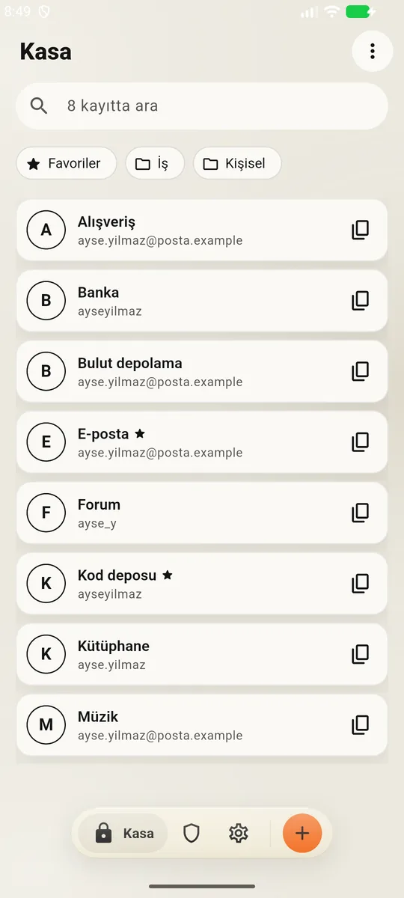
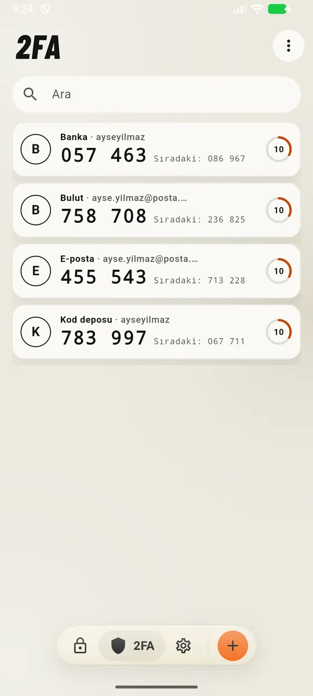
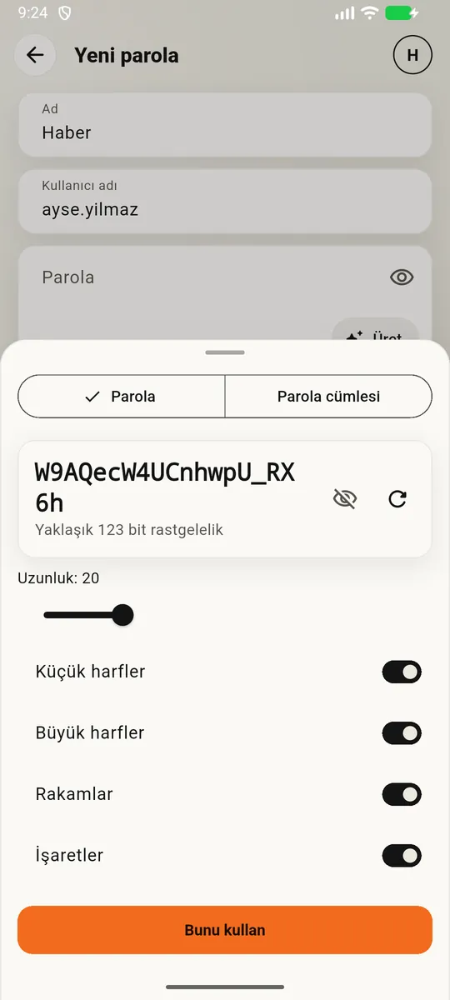
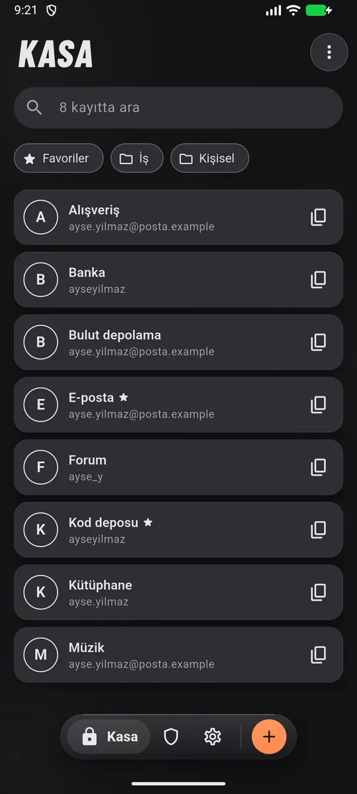

<div align="center">


# KeyKey

**Android için hesapsız, sunucusuz, açık kaynak parola yöneticisi ve 2FA doğrulayıcı.**

[](https://github.com/aaudraa/KeyKey/releases/latest)
[](https://github.com/aaudraa/KeyKey/actions/workflows/ci.yml)

[](resources/docs/yayin.md)
[](LICENSE)

[](https://github.com/aaudraa/KeyKey/releases/latest)
[](https://apps.obtainium.imranr.dev/redirect?r=obtainium://app/%7B%22id%22%3A%22io.github.aaudraa.keykey%22%2C%22url%22%3A%22https%3A%2F%2Fgithub.com%2Faaudraa%2FKeyKey%22%2C%22author%22%3A%22aaudraa%22%2C%22name%22%3A%22KeyKey%22%7D)

[Kullanım kılavuzu](resources/docs/kullanim.md) · [Güvenlik tasarımı](resources/docs/guvenlik-tasarimi.md) · [Değişiklik günlüğü](resources/CHANGELOG.md) · [English](#in-english)






</div>

> [!IMPORTANT]
> KeyKey bağımsız bir güvenlik denetiminden geçmedi. Kodun en kritik bölümleri (şifreleme, kilit, senkron, yedek ve otomatik doldurma) 2026-11-21'de çok ajanlı bir yapay zekâ incelemesinden geçirildi; bulgular [#168](https://github.com/aaudraa/KeyKey/issues/168)'de açıkça listeleniyor ve 1.8.1'de düzeltilecek. Şifreli yedeğini düzenli al ve telefonun dışında da sakla.

## Neden KeyKey?

- **Verilerin sende kalır.** KeyKey'in sunucusu ve hesabı yok; her şey telefonunda şifreli olarak durur.
- **Parolaların şifresiz hiçbir yere gitmez.** İnternete yalnızca senin açtığın iki özellik çıkar: sızıntı kontrolüne parola özetinin ilk 5 karakteri gider; isteğe bağlı senkron, kasanı kendi WebDAV sunucun (Nextcloud, ownCloud…) üzerinden ana parolanla uçtan uca şifreli eşitler. Ağ kodunun bu iki dosyada kaldığı her derlemede otomatik olarak denetlenir.
- **Yedeğin senin kontrolünde.** Şifreli yedeği istediğin klasöre elle ya da otomatik olarak alırsın.
- **Kodu açık, derlemesi doğrulanabilir.** Uygulamanın ne yaptığını herkes inceleyebilir; yayımlanan APK, F-Droid'in derleme aracıyla birebir aynı çıkar.

## Özellikler

| Alan | Özellikler |
|---|---|
| **Parola kasası** | Arama, klasörler, favoriler, toplu seçim, çöp kutusu, parola geçmişi; parola üretici ve güç ölçer; zayıf ve tekrar eden parolaları gösteren parola raporu; isteğe bağlı sızıntı kontrolü (Have I Been Pwned) |
| **Kartlar ve notlar** | Banka kartları (numara, son kullanma, güvenlik kodu, PIN; marka numaradan anlaşılır) ve güvenli notlar, kendi sekmelerinde |
| **2FA doğrulama** | TOTP, HOTP ve Steam Guard kodları; QR ile ekleme; Google Authenticator, Aegis ve 2FAS'tan aktarım; kodları göstermek için isteğe bağlı ek onay |
| **Otomatik doldurma** | Android uygulamalarında ve tarayıcılarda parola doldurma ve kaydetme, ödeme formlarında kart doldurma; uygulamalar imza sertifikasıyla eşleşir, şüpheli durumlarda uyarı verilir |
| **Kilit** | Ana parola, parmak iziyle açma, kurtarma anahtarı; otomatik kilitlenme ve arka planda kilitlenme süresi |
| **Yedekleme** | Şifreli yedek, otomatik yedek ve geri yükleme; Bitwarden, Chrome, Firefox ve KeePassXC'den içe aktarma, KeePass dosyalarını (`.kdbx`) doğrudan açma; başka bir parola yöneticisine geçmek için şifresiz dışa aktarma (CSV ya da JSON) |
| **Senkron** | Kendi WebDAV sunucun üzerinden telefonlar arasında uçtan uca şifreli eşitleme; yeni telefonu senkrondan kurma, başka kasası olan telefonu katma |
| **Görünüm** | Açık, koyu ya da sistem teması; Türkçe ve İngilizce |

## Kurulum

KeyKey Android 11 ve üstünde çalışır.

- **GitHub:** [Son sürümü indir](https://github.com/aaudraa/KeyKey/releases/latest) (`keykey-<sürüm>.apk`). İndirdiğin APK'yı [doğrulamak](resources/docs/yayin.md) için imza sertifikasının SHA-256 özeti:

  ```
  66ff7b5c0c009a8530d0a55dd1d80a3af35de48bd0667c456a0cf86a6d1129a0
  ```

- **Obtainium:** [Obtainium'a ekle](https://apps.obtainium.imranr.dev/redirect?r=obtainium://app/%7B%22id%22%3A%22io.github.aaudraa.keykey%22%2C%22url%22%3A%22https%3A%2F%2Fgithub.com%2Faaudraa%2FKeyKey%22%2C%22author%22%3A%22aaudraa%22%2C%22name%22%3A%22KeyKey%22%7D); yeni sürümler GitHub'dan kendiliğinden gelir.
- **F-Droid:** Şimdilik yok. İlk başvuru 2026-11-18'de kabul edilmedi ([fdroiddata!57995](https://gitlab.com/fdroid/fdroiddata/-/merge_requests/57995)); derleme F-Droid'in aracıyla birebir aynı çıkmaya devam ediyor.

İlk kasa, otomatik doldurma, 2FA, yedekleme ve bilinen sınırlar ekran görüntüleriyle [kullanım kılavuzunda](resources/docs/kullanim.md). Eski bir `v0.x` deneme sürümü kullanıyorsan önce [geçiş adımlarını](resources/docs/yayin.md#eski-sürümlerden-geçiş) oku.

## Güvenlik yaklaşımı

- Kasanın şifrelemesi için kendi kriptografimizi yazmıyoruz; denenmiş [libsodium](https://libsodium.org) kütüphanesini kullanıyoruz.
- Ana parolandan anahtar türetmek için **Argon2id**, verileri şifrelemek için **XChaCha20-Poly1305** kullanılıyor.
- 2FA kodları (TOTP, HOTP) ve başka uygulamaların şifreli dışa aktarmalarını açmak için gereken birkaç standart algoritmayı biz uyguluyoruz; hepsi RFC test vektörleriyle doğrulanıyor.
- Ana parola hiçbir yerde saklanmaz. Onu ve kurtarma anahtarını birlikte kaybedersen verilerin geri getirilemez; bunu yapabilecek bir sunucu ya da arka kapı yok. Senkron sunucusu da yalnızca şifreli dosya görür.
- KeyKey hiçbir veri toplamaz ([gizlilik bildirimi](resources/docs/gizlilik.md)).

Neyin korunduğu ve neyin korunmadığı [güvenlik tasarımı belgesinin](resources/docs/guvenlik-tasarimi.md) "Tehdit modeli" ve "Bilinen sınırlar" bölümlerinde. Projenin OWASP MASVS'e göre yaptığı kendi denetiminin sonuçları [denetim belgesinde](resources/docs/guvenlik-denetimi.md).

Bir güvenlik açığı bulursan lütfen [güvenlik politikasındaki](.github/SECURITY.md) adımları izle, herkese açık issue açma.

## Proje hakkında

KeyKey'in kodunun büyük kısmı bir yapay zekâ kodlama asistanıyla yazıldı; yönü ve kararları proje sahibi belirledi, uygulamayı kendi telefonunda kullanarak denedi. Bu yüzden testlere, belgelenmiş kararlara ve dışarıdan incelemeye ayrıca önem veriliyor:

- 2000'e yakın Dart birim testi ve Kotlin testleri her değişiklikte CI'da koşuyor; emülatör testleri her fazın sonunda çalıştırılıyor.
- CI her değişiklikte gizli bilgi taraması ve APK güvenlik denetimi yapıyor; derlemeyi etkileyen değişikliklerde ve her hafta APK, F-Droid'in aracıyla yeniden derlenip bizimkiyle karşılaştırılıyor.
- Her kararın gerekçesi [yol haritasında](resources/yol-haritasi.md) yazılı. İnceleme ve geri bildirim için [issue'lar](https://github.com/aaudraa/KeyKey/issues) açık.

| Belge | İçerik |
|---|---|
| [Kullanım kılavuzu](resources/docs/kullanim.md) | Kurulumdan yedeklemeye adım adım, ekran görüntüleriyle |
| [Güvenlik tasarımı](resources/docs/guvenlik-tasarimi.md) | Tehdit modeli, anahtar hiyerarşisi, bilinen sınırlar |
| [Güvenlik denetimi](resources/docs/guvenlik-denetimi.md) | OWASP MASVS'e göre kendi denetimimiz |
| [Senkron](resources/docs/senkron.md) | Senkronun tasarımı: dosyalar, birleştirme, çakışmalar |
| [Yayın ve doğrulama](resources/docs/yayin.md) | Sürüm numarası, imza, yeniden üretilebilir derleme |
| [Bağımlılıklar](resources/docs/bagimliliklar.md) | Kullanılan paketler, lisanslar, derlemede indirilenler |
| [Değişiklik günlüğü](resources/CHANGELOG.md) | Sürümlerde ne değişti |
| [Yol haritası](resources/yol-haritasi.md) | Fazlar, kararlar, sıradaki işler |

## Geliştirme

[Flutter](https://flutter.dev) ve Dart, Android'e özgü bölümler için Kotlin. Kasa, kaynaktan derlenen SQLite üstünde kayıt kayıt şifreli tutulur. Proje fazlar halinde ilerliyor ve her fazın kendi dalı var; çalışma düzeni [yol haritasında](resources/yol-haritasi.md#çalışma-düzeni), katkı kuralları [katkı rehberinde](.github/CONTRIBUTING.md).

<details>
<summary><b>Windows'ta kurulum</b></summary>

1. [Flutter](https://docs.flutter.dev/get-started) ve Android Studio'yu kur.
2. [Git for Windows](https://git-scm.com/install/windows) kurup `C:\Program Files\Git\bin` klasörünü PATH'e ekle.
3. GNU Make kur: `winget install ezwinports.make`
4. Visual Studio'yu "Desktop development with C++" iş yüküyle kur.
5. Düzenleyiciyi yeniden başlat, sonra çalıştır:

```powershell
flutter pub get
flutter test
flutter run

# Emülatör testleri, çalışan bir emülatör gerekir
flutter test integration_test -d <emülatör>

# Parmak izi, pano ve kamera betikleri dahil bütün cihaz testleri
bash resources/scripts/all-device-tests.sh <emülatör>
```

Repoyu `C:\KeyKey` gibi kısa bir yola klonla. Uzun yollarda libsodium derlemesi hata verebiliyor. Ayrıntılar yol haritasının [Geliştirme ortamı](resources/yol-haritasi.md#geliştirme-ortamı) bölümünde.

</details>

## In English

KeyKey is an open-source password manager and 2FA authenticator for Android 11+, with no account and no server. The vault stays encrypted on your phone (libsodium: Argon2id and XChaCha20-Poly1305). Optional end-to-end encrypted sync goes through your own WebDAV server (Nextcloud, ownCloud…). The app is available in English and Turkish; the project's documents are in Turkish.

- Password vault, bank cards and secure notes, TOTP/HOTP/Steam codes, autofill for apps and browsers, encrypted and automatic backups, imports from Bitwarden, Chrome, Firefox, KeePassXC, KeePass (.kdbx) files, Google Authenticator, Aegis and 2FAS.
- Most of the code was written with an AI coding assistant; the owner set the direction and tested it on their own phone. It has not had an independent security audit. Findings of a multi-agent AI review of its most critical parts (crypto, lock, sync, backup, autofill) are listed openly in [#168](https://github.com/aaudraa/KeyKey/issues/168).
- English documents: [security design summary](resources/docs/security-summary.md), [privacy policy](resources/docs/privacy.md), [terms of use](resources/docs/terms.md) and [security policy](.github/SECURITY.md#security-policy).
- Download the APK from [the latest release](https://github.com/aaudraa/KeyKey/releases/latest) or add it to [Obtainium](https://apps.obtainium.imranr.dev/redirect?r=obtainium://app/%7B%22id%22%3A%22io.github.aaudraa.keykey%22%2C%22url%22%3A%22https%3A%2F%2Fgithub.com%2Faaudraa%2FKeyKey%22%2C%22author%22%3A%22aaudraa%22%2C%22name%22%3A%22KeyKey%22%7D). Signing certificate SHA-256: `66ff7b5c0c009a8530d0a55dd1d80a3af35de48bd0667c456a0cf86a6d1129a0`.

## Lisans

© 2026 KeyKey geliştiricileri. KeyKey, [GNU GPL v3.0](LICENSE) lisansıyla dağıtılır: kaynak kodunu inceleyebilir, değiştirebilir ve aynı lisansla paylaşabilirsin. KeyKey **hiçbir garanti olmadan**, olduğu gibi sunulur (lisansın 15. ve 16. maddeleri). Uygulamayı ilk açtığında [kullanım koşulları](resources/docs/kosullar.md) ([English](resources/docs/terms.md)) gösterilir. Kullanılan kütüphanelerin lisansları uygulamada Ayarlar → Hakkında → Lisanslar'da ve [bağımlılıklar belgesinde](resources/docs/bagimliliklar.md).
