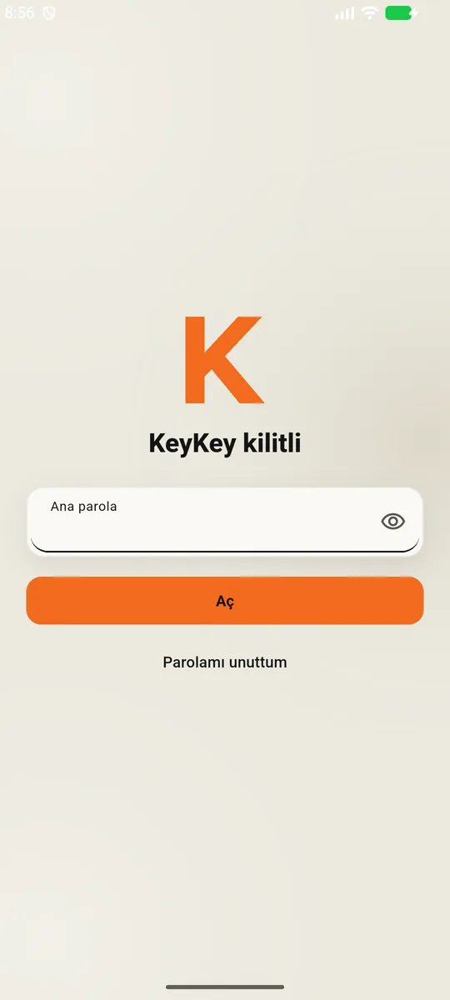
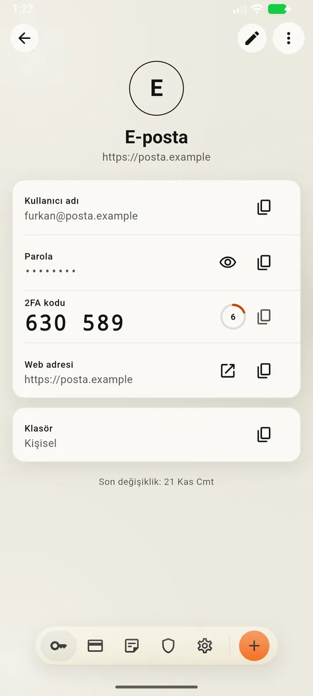
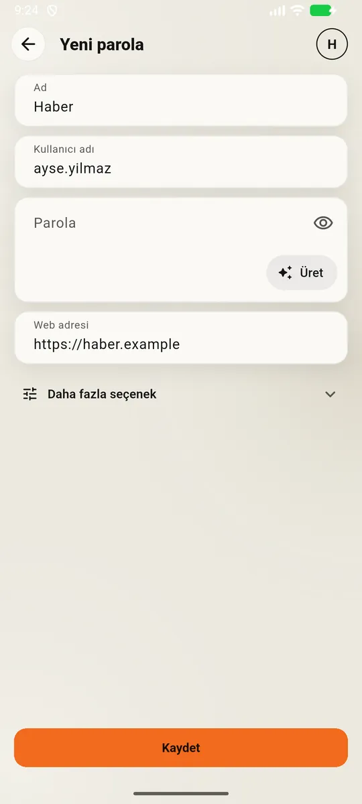
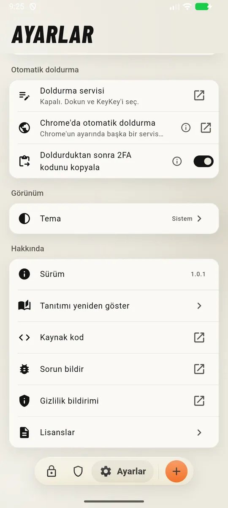
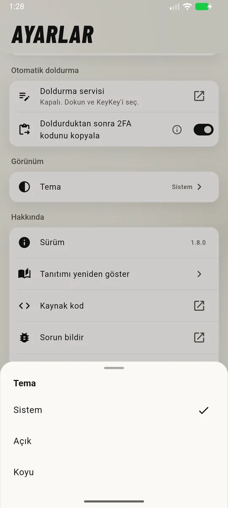
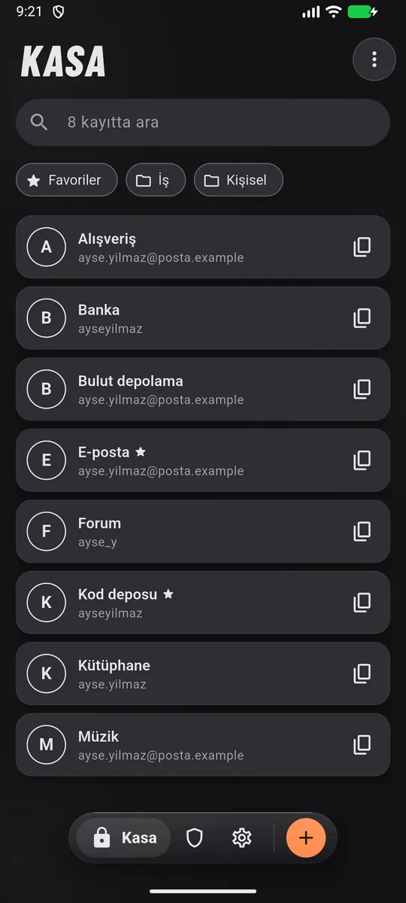

# KeyKey kullanım kılavuzu

KeyKey, parolalarını, kartlarını, güvenli notlarını ve 2FA kodlarını yalnızca telefonunda, şifreli olarak saklayan bir uygulama. Hesap açman gerekmez, sunucusu yoktur; internete yalnızca senin başlattığın sızıntı kontrolü için çıkar. Bu kılavuz kurulumdan yedeklemeye kadar her şeyi adım adım anlatıyor.

Görüntülerdeki kayıtlar örnektir.

## İçindekiler

- [Kurulum](#kurulum)
- [İlk kasa](#ilk-kasa)
- [Kilit ve parmak izi](#kilit-ve-parmak-izi)
- [Parolalar](#parolalar)
- [Kartlar ve güvenli notlar](#kartlar-ve-güvenli-notlar)
- [2FA kodları](#2fa-kodları)
- [Otomatik doldurma](#otomatik-doldurma)
- [Passkey'ler](#passkeyler)
- [Yedekleme ve yeni telefona geçiş](#yedekleme-ve-yeni-telefona-geçiş)
- [Senkron](#senkron)
- [Başka uygulamalardan geçiş](#başka-uygulamalardan-geçiş)
- [Görünüm](#görünüm)
- [Bilinen sınırlar](#bilinen-sınırlar)

## Kurulum

KeyKey Android 11 ve üstünde çalışır. Şimdilik yalnızca GitHub'dan dağıtılıyor.

1. [Sürümler sayfasından](https://github.com/aaudraa/KeyKey/releases) son sürümün `keykey-<sürüm>.apk` dosyasını indir.
2. Dosyayı aç. Telefon, tarayıcının ya da dosya uygulamasının uygulama yüklemesine izin vermeni isteyebilir; izin verip kur.
3. Google Play Protect, KeyKey'i daha önce görmediği için uygulama taraması önerebilir. Taramayı seçersen APK Google'a gönderilir. Göndermek istemezsen "Diğer ayrıntılar"ı açıp "Taramadan yükle"ye dokun (İngilizce arayüzde "More details" → "Install without scanning").

**Güncellemeler için:** [Obtainium](https://github.com/ImranR98/Obtainium) uygulamasına bu deponun adresini (`https://github.com/aaudraa/KeyKey`) eklersen yeni sürüm çıktığında haber verir ve kurar. Telefonda Obtainium kuruluysa [bu bağlantıyla](https://apps.obtainium.imranr.dev/redirect?r=obtainium://app/%7B%22id%22%3A%22io.github.aaudraa.keykey%22%2C%22url%22%3A%22https%3A%2F%2Fgithub.com%2Faaudraa%2FKeyKey%22%2C%22author%22%3A%22aaudraa%22%2C%22name%22%3A%22KeyKey%22%7D) KeyKey'i tek dokunuşla ekleyebilirsin. Bağlantı önce tarayıcıda Obtainium'un yönlendirme sayfasını açar. Chrome'da Obtainium kendiliğinden açılır; açılmazsa (Firefox'ta böyle) sayfadaki "Click here if you are not redirected" düğmesine dokun. Obtainium kurulu değilse aynı sayfada indirme bağlantısı var. Obtainium içe aktarmayı onaylamanı ister; eklendikten sonra en son sürüm "Bilinmeyen" görünürse listeyi aşağı çekip yenile. KeyKey telefonda henüz yoksa listede "Kurulu değil" görünür: üstüne dokunup kur düğmesine bas. Android ilk seferde Obtainium'a uygulama yükleme izni vermeni ister (Samsung'da "Bilinmeyen uygulamaları yükle" listesinde Obtainium'un düğmesini aç, sonra geri dön); Play Protect de yukarıdaki uyarıyı gösterebilir.

**İndirdiğin uygulamanın gerçekten KeyKey olduğunu denetlemek için:** [AppVerifier](https://github.com/soupslurpr/AppVerifier) gibi bir uygulamayla KeyKey'in imza özetine bak. Şu değer olmalı:

```
66ff7b5c0c009a8530d0a55dd1d80a3af35de48bd0667c456a0cf86a6d1129a0
```

Bilgisayarda denetlemek istersen [yayın belgesindeki](yayin.md) "İndirilen APK'yı doğrulamak" adımlarını izle.

## İlk kasa

Uygulamayı ilk açtığında kısa, hareketli bir tanıtım gelir: KeyKey'in ne olduğu, menüde nerede ne bulunduğu, otomatik doldurma, başka uygulamalardan geçiş ve yedek. Kaydırarak ya da **İleri** ile geçebilir, sağ üstteki **Atla** ile hemen kasa oluşturmaya geçebilirsin. Sonra yeniden izlemek istersen: Ayarlar → Hakkında → **Tanıtımı yeniden göster**.

Kasa oluşturmadan önce [kullanım koşulları](kosullar.md) gelir: verilerinin nerede durduğu, kasanın nasıl korunduğu, nelerin senin elinde olduğu ve garanti olmadığı. "Okudum, anladım ve kabul ediyorum" kutusunu işaretleyip **Kabul et ve devam et**'e dokunursun. Koşullar bir kez sorulur; Ayarlar → Hakkında → **Kullanım koşulları**'ndan yeniden okuyabilirsin. KeyKey'i daha önce kullanıyorsan güncellemeden sonra kilit ekranından önce bir kez gösterilir.

 

1. **Ana parolanı seç.** Kasanı bu parola korur. En az 10 karakter olmalı; birbiriyle ilgisiz birkaç kelimeden oluşan bir cümle hem güçlü hem akılda kalıcıdır. Güç göstergesi parolanın ne kadar tahmin edilebilir olduğunu söyler.
2. **Kurtarma anahtarını kaydet.** Kasa oluşunca uzun bir kurtarma anahtarı gösterilir. Ana parolanı unutursan kasanı yalnızca bu açar. Yalnızca bu bir kez gösterilir, KeyKey onu saklamaz. Ekran görüntüsü alınamaz; kağıda yazabilir, **Kopyala** ile başka bir parola yöneticisine yapıştırabilir ya da **Dosyaya kaydet** ile metin dosyası olarak kaydedebilirsin. Dosyayı telefonda bırakma: anahtarı bulan kasanı açabilir. Sonraki adımda anahtarı yazar, yapıştırır ya da **Dosyadan oku** ile kaydettiğin dosyadan alırsın.
3. **Anahtarı doğrula.** Yazdığını göstermek için anahtarı bir kez yazarsın, kasa açılır.

> [!IMPORTANT]
> Ana parolanı da kurtarma anahtarını da kaybedersen verilerin geri getirilemez. Bunu yapabilecek bir sunucu ya da arka kapı yok.

Eski telefonundan bir KeyKey yedeğin varsa kasa oluşturmak yerine **Yedekten geri yükle**'ye dokun ([ayrıntılar](#yedekleme-ve-yeni-telefona-geçiş)).

## Kilit ve parmak izi



- KeyKey arka plana geçtiği anda ve 5 dakika dokunulmazsa kilitlenir. Ayarlar'daki **Şimdi kilitle** ile hemen kilitleyebilirsin.
- **Arka planda kilitlenme:** Ayarlar → Güvenlik'te **Hemen** yerine **30 saniye** ya da **1 dakika** seçebilirsin. O zaman bir koda bakmak için başka bir uygulamaya geçip bu süre dolmadan döndüğünde kasa açık kalır. Bu sürede telefonu eline alan biri de kasayı açık bulur; telefon uyusa ya da saati değiştirilse bile süre uzamaz. 5 dakika dokunulmayınca kilitlenme ayrıca sürer. Kilidi açınca kaldığın yere dönersin: 2FA sekmesindeysen 2FA'ya, bir kaydın, kartın ya da notun ayrıntısındaysan ona.
- **Parmak izi:** Ayarlar → Güvenlik → **Parmak iziyle aç**. Telefonunda parmak izi kayıtlı olmalı. Ana parola her zaman geçerlidir. Telefona yeni bir parmak izi eklersen ya da ekran kilidini kaldırırsan güvenlik gereği parmak iziyle açma kapanır; ana parolayla açıp yeniden açabilirsin.
- **Yanlış parola:** Birkaç hatalı denemeden sonra yeni deneme için kısa bir süre beklemen gerekir; süre denemeler arttıkça uzar.
- **Parolamı unuttum:** Kilit ekranındaki bu bağlantıyla kurtarma anahtarını girip kasayı açarsın, ardından yeni bir ana parola belirlersin.
- **Kurtarma anahtarını kaybettiysen:** Ayarlar → Güvenlik → **Yeni kurtarma anahtarı**. Ana parolanı girersin, yeni anahtar bir kez gösterilir; kâğıda yaz ya da **Dosyaya kaydet** ile kaydet, sonra geri yazınca kaydedilir. Bu sırada başka bir uygulamaya geçersen kasa kilitlenir ve yenileme iptal olur; eski anahtar geçerli kalır ve KeyKey bunu kilidi açınca söyler. Eski anahtar artık bu kasayı açmaz, ama daha önce aldığın yedekleri açmaya devam eder; yeni bir yedek alıp eskilerini sil.
- **Ana parolayı değiştirmek için:** Ayarlar → Güvenlik → **Ana parolayı değiştir**. Daha önce aldığın yedekler, otomatik yedek klasöründekiler de, eski parolayla açılmaya devam eder; değişiklikten sonra çıkan nottan yeni bir yedek alıp eskilerini silebilirsin. Otomatik yedek açıksa yeni parolalı yedek hemen klasöre yazılır.

## Parolalar

 

Alttaki menüde **Parolalar**, **Kartlar** ve **Notlar** ayrı sekmelerdir; her biri yalnızca kendi kayıtlarını, kendi klasörlerini ve kendi çöp kutusunu gösterir. Üstteki kutuyla arayabilir, **Favoriler** ve klasör düğmeleriyle süzebilirsin. Sağ üstteki **⋮** menüsünden ada ya da son değişene göre sıralarsın; seçimin kilitten sonra da kalır. Parola satırının sağındaki simge parolayı doğrudan kopyalar.

**Birden çok kaydı birlikte taşımak ya da silmek için** bir satıra uzun bas: seçim başlar ve üstte seçili sayısı görünür. Başka satırlara dokunarak seçer ya da bırakırsın. Üstteki düğmelerle **Tümünü seç** (yalnızca arama ve süzgeçte görünenler), **Klasöre taşı** (var olan bir klasör, yeni klasör ya da **Klasörden çıkar**) ve **Çöp kutusuna taşı**; çöpe taşıdıktan sonra alttaki **Geri al** hepsini geri getirir. Kartlar ve Notlar sekmelerinde de aynıdır. Geri tuşu ya da soldaki **×** seçimi kapatır.

Parolalar boşken başka bir uygulamadan **İçe aktar** ya da **Yedekten geri yükle** kısayollarını da görürsün.

Bir kayda dokununca ayrıntıları açılır: kullanıcı adı, parola, bağlı 2FA kodu, web adresi ve klasör. Her satırın yanında kopyalama düğmesi var. Parola **Göster**'e dokunana kadar gizli kalır. Web adresinin yanındaki **Siteyi aç** sayfayı tarayıcında açar. Düzenlemek için üstteki kalem simgesine dokun. Kaydı favorilere eklemek ya da çöpe taşımak için ayrıntı ekranının sağ üstündeki **⋮** menüsünü kullan.

**Kopyalanan parola 30 saniye sonra panodan kendiliğinden silinir.** Android 13 ve üstünde pano önizlemesinde de görünmez.

### Yeni parola

  

1. Alttaki turuncu **+** düğmesine dokun ve **Parola**'yı seç.
2. Ad, kullanıcı adı, parola ve web adresini yaz. Not, klasör, özel alan ve başka site **Daha fazla seçenek**'in altında. Klasör kutusu var olan klasörlerini önerir.
3. Yeni bir parola istiyorsan **Üret**'e dokun. Rastgele karakterlerden ya da kelimelerden (**Parola cümlesi**) parola üretebilir, uzunluğunu ve içereceği karakterleri seçebilirsin. **Bunu kullan** parolayı forma koyar; seçtiğin uzunluk ve türler bir dahaki sefere hatırlanır.
4. **Kaydet**.

Bir parolayı değiştirdiğinde eskisi kaydın geçmişinde kalır.

### Çöp kutusu ve parola raporu

Parolalar ekranının sağ üstündeki **⋮** menüsünde:

- **Çöp kutusu:** Sildiğin parolalar burada 30 gün durur, sonra kalıcı olarak silinir. Yanlışlıkla sildiğini buradan geri yüklersin. Çöp kutusunun **⋮** menüsünde **Tümünü geri yükle** ve onay isteyen **Çöpü boşalt** var.
- **Parola raporu:** Zayıf ve birden çok kayıtta kullandığın parolaları gösterir. Bunlar telefonda hesaplanır, hiçbir yere gönderilmez. İnternete yalnızca aşağıdaki sızıntı kontrolü çıkar, o da sen dokununca.
- **Sızıntı kontrolü:** Raporun en üstündeki **İnternetten denetle**, parolalarının bilinen veri sızıntılarında görülüp görülmediğini Have I Been Pwned'a sorar. Parolanın kendisi gitmez: yalnızca özetinin ilk 5 karakteri gider, karşılaştırma telefonda yapılır. Have I Been Pwned IP adresini görür. Sızıntılarda görülen parolalar kaç kez görüldükleriyle listelenir; kayda dokunup parolayı değiştir, aynı parolayı kullandığın başka yerler varsa onları da. "Görülmedi" demek "güvenli" demek değildir. Sonuç kaydedilmez; ekrandan çıkınca ya da kasa kilitlenince silinir. Bağlantı yoksa "Denetlenemedi" yazar, **Yeniden dene** ile tekrar denersin.

## Kartlar ve güvenli notlar

Kartlar alttaki menünün **Kartlar** sekmesinde, notlar **Notlar** sekmesinde durur. Her sekmenin **⋮** menüsünde kendi çöp kutusu vardır.

**Kart eklemek için:** **+** → **Kart**. Kartın adını (örneğin "Maaş kartı"), kart sahibini, numarayı, son kullanma tarihini (AA/YY), güvenlik kodunu ve istersen PIN'i yaz. Numarayı yazarken ya da yapıştırırken boşluk ve tireler kendiliğinden düzelir; marka (Visa, Mastercard, Troy…) numaradan anlaşılır. Numara bir kart numarasına benzemiyorsa altında uyarı çıkar ama yine kaydedebilirsin.

- Listede kartın yalnızca son dört hanesi ve son kullanma tarihi görünür; süresi geçmişse **Süresi doldu** yazar. Satırın sağındaki düğme numarayı kopyalar.
- Ayrıntı ekranında numara, güvenlik kodu ve PIN gizli gelir; **Göster**'e dokununca açılır. Kopyalanan değer 30 saniye sonra panodan silinir.

**Güvenli not eklemek için:** **+** → **Güvenli not**. Wi-Fi parolası, kapı kodu, kurtarma kodları gibi bir kayda uymayan sırlar için. Bir not en çok 64 KB metin taşır; fazlasını yapıştırırsan eklenmez ve bunu söyler.

- Listede notun yalnızca adı görünür, metni görünmez. Arama da yalnızca ada ve klasöre bakar.
- Ayrıntı ekranında metnin bir kısmını seçip **Kopyala** diyebilir ya da **Metni kopyala** ile hepsini kopyalayabilirsin. Kopyalanan metin de 30 saniye sonra panodan silinir.

Kartlar ve notlar da klasöre konabilir, favorilere eklenebilir; sildiğinde çöp kutusuna gider. Yedeğe, otomatik yedeğe ve şifresiz dışa aktarmaya (JSON) girerler.

Düzenleme ekranlarında bir metni seçip **Kopyala** ya da **Kes** dersen o da 30 saniye sonra panodan silinir.

**Eski sürümle açma:** Kart ya da not içeren bir yedeği KeyKey 1.3.0 ve öncesi açamaz ve "Yedek bozuk ya da değiştirilmiş" der. Yedek bozuk değildir, KeyKey'i güncellemen yeter. Kartın ve notun yoksa yedek eski sürümlerde de açılır.

## 2FA kodları


KeyKey, Google Authenticator gibi bir doğrulama uygulamasının yerini tutar: giriş yaparken istenen 6 haneli kodları üretir.

**Hesap eklemek için** **+** → **2FA kodu**, sonra:

- **QR kodu tara:** Sitenin iki adımlı doğrulama ayarında gösterdiği QR kodunu kamerayla okut.
- **Görseldeki QR kodunu oku:** QR kodun ekran görüntüsü ya da fotoğrafı varsa onu seç.
- **Anahtarı elle gir:** Site QR yerine bir metin anahtarı veriyorsa onu yaz.
- **Başka uygulamadan aktar:** Google Authenticator'ın dışa aktarma QR'ları, Aegis ve 2FAS dosyaları.

Henüz hesabın yoksa listedeki **Başka uygulamadan aktar** kısayolu da aynı yere götürür. Aynı gizli anahtarla bir hesap zaten varsa (çöp kutusundakiler de) KeyKey uyarır; istersen yine de eklersin.

**Steam Guard:** Steam hesabını Aegis ya da 2FAS'tan aktarabilir, Steam bağlantısını taratabilir ya da elle eklerken **Gelişmiş** altında **Steam Guard** türünü seçebilirsin. Kod 5 karakterdir (harf ve rakam). Steam'in kendi uygulamasındaki giriş ve takas onayları KeyKey'de yoktur, yalnızca kod üretilir.

**Kullanırken:** Koda dokununca kopyalanır. Sağdaki halka kodun kaç saniye daha geçerli olduğunu gösterir; son saniyelerde atmaya başlar. Karta uzun basınca düzenleme, favori ve silme seçenekleri açılır.

Bir parola kaydıyla aynı siteye ait 2FA hesabı o kayda bağlanabilir. Kodu o zaman kaydın ayrıntısında da görürsün.

**Ek onay (isteğe bağlı):** Ayarlar → Güvenlik → **2FA kodlarını göstermeden önce doğrula** açıksa, kodlar gösterilmeden önce parmak izi ya da ana parola istenir. Kilidi açık telefonun başkasının eline geçmesine karşı ek bir katmandır.

**Eski sürümle açma:** KeyKey 1.7.0'ın aldığı yedekleri 1.6.0 ve öncesi açamaz ve "daha yeni bir yedek" der (1.3.0 ve öncesi "bozuk ya da değiştirilmiş" der). Yedek bozuk değildir, KeyKey'i güncellemen yeter.

## Otomatik doldurma



KeyKey, uygulamalardaki ve Chrome'daki giriş formlarını ve ödeme formlarındaki kart bilgilerini doldurabilir, yeni girdiğin parolaları kaydetmeyi önerebilir.

**Açmak için:**

1. Ayarlar → Otomatik doldurma → **Doldurma servisi**'ne dokun ve açılan listeden **KeyKey**'i seç.
2. Chrome kullanıyorsan **Chrome'da otomatik doldurma**'ya dokun. Chrome'un ayarında "başka bir servisle otomatik doldurma" seçeneğini seç, ardından Chrome'un gösterdiği **Chrome'u yeniden başlat** düğmesine dokun. Dokunmazsan seçim kaybolur.

**Kullanırken:**

- Bir giriş kutusuna dokununca klavyenin üstünde ya da kutunun altında **KeyKey ile doldur** önerisi çıkar. Dokunursun, KeyKey'i parmak izi ya da ana parolayla açarsın.
- O uygulamaya ya da siteye ait tek bir kayıt varsa hemen doldurulur ve "… dolduruldu" bildirimi çıkar. Birden fazla varsa listeden seçersin.
- **Uyarılar:** KeyKey bir şeyden emin olmadığında doldurmadan önce sorar. Örneğin kayıt bu uygulamaya bağlı değilse, sayfa şifresiz (`http`) bağlantıyla açılmışsa ya da uygulamanın imzası kayıttakinden farklıysa (sahte uygulama olabilir). Uyarıyı okumadan geçme.
- İlk kez bir uygulamada doldururken kaydı o uygulamaya bağlayabilirsin; sonraki seferler kendiliğinden eşleşir. Bağlama, uygulamanın imza sertifikasıyla yapılır, yani aynı adı taşıyan sahte bir uygulama eşleşmez.
- **Uygulamanın sitesi:** Uygulama bir sitenin resmî uygulamasıysa ve site bunu onaylıyorsa, o sitenin kaydı uygulamada da kendiliğinden eşleşir; ilk doldurmada uygulama kayda kendisi bağlanır. Android 12 ve üstünde Android'in zaten doğruladığı siteler kullanılır, internete çıkılmaz. Android'in doğrulamadığı durumlar için Ayarlar → Otomatik doldurma → **Uygulamanın sitesini internetten doğrula**'yı açabilirsin (varsayılan kapalı): KeyKey o zaman sitenin `assetlinks.json` dosyasını okur. Siteye kasandan bir şey gitmez ([gizlilik](gizlilik.md#uygulamanın-sitesini-doğrulama)).
- **Kaydetme:** Yeni bir hesap açtığında ya da parolanı değiştirdiğinde Android kaydetmeyi önerir. KeyKey'in ekranında kaydı görür, istersen düzenleyip kaydedersin.
- **2FA kodu:** Doldurduğun kayda bağlı bir 2FA hesabı varsa güncel kod panoya kopyalanır; kod kutusuna yapıştırman yeter. Ayarlar'daki **Doldurduktan sonra 2FA kodunu kopyala** ile kapatılabilir.

**Kart doldurma:**

- Ödeme formunda kart numarası, son kullanma ya da güvenlik kodu kutusuna dokununca **KeyKey ile kart doldur** önerisi çıkar. KeyKey'i açarsın, kartlarının listesinden birini seçersin; numara, kart sahibi, son kullanma ve güvenlik kodu birlikte dolar. PIN hiçbir yere doldurulmaz.
- Kart hiçbir siteye ya da uygulamaya bağlı değildir, bu yüzden her seferinde listeden seçersin. Listenin başlığında kartın gideceği site ya da uygulama yazar; seçmeden önce ona bak.
- Sayfa şifresiz (`http`) bağlantıyla açılmışsa KeyKey doldurmadan önce uyarır.
- Kasanda kart yoksa da öneri çıkar (KeyKey kasayı açmadan kartın olup olmadığını bilemez); liste kart olmadığını söyler.
- Forma elle yazdığın yeni bir kartı KeyKey kaydetmeyi önermez; kartı **+** → **Kart** ile eklersin.

## Passkey'ler

Passkey, parolanın yerine geçen bir giriş anahtarıdır: site senin yerine bir parola saklamaz, telefonun girişte bir imza atar. Sızdırılamaz ve sahte bir siteye girilemez. KeyKey 1.11.0'dan beri, **Android 14 ve üstünde** passkey'lerini kasanda tutabilir; kasan gibi yedeğe ve senkrona girer, yeni telefona geçer.

**Açmak için:** Ayarlar → Otomatik doldurma → **Passkey sağlayıcısı**'na dokun. Android'in parola ve passkey hizmetleri ayarı açılır (adı Android sürümüne göre "Parolalar ve hesaplar" ya da "Parolalar ve passkey'ler"); orada **KeyKey**'i tercih edilen hizmet olarak seç. Bu satır Android 13 ve öncesinde görünmez.

- **Oluşturmak:** Bir sitede ya da uygulamada "passkey oluştur" dediğinde Android'in penceresinde **KeyKey**'i seç. KeyKey'in kilidini açarsın; site, hesap ve passkey'in kaydedileceği kayıt gösterilir. **Passkey oluştur**'a dokununca passkey o sitenin kaydına eklenir; kayıt yoksa yeni bir kayıt açılır.
- **Giriş:** Site passkey istediğinde Android'in penceresinde **KeyKey'in kilidini aç**'a dokun ve kasayı aç. O sitenin hesapları aynı pencerede listelenir; birini seçince giriş yapılır. KeyKey, kasa kilitliyken hangi sitelerde passkey'in olduğunu kimseye söylemez; bu yüzden pencere önce kilit açmayı ister.
- **Uyarı:** Passkey'i bir uygulama istiyorsa ve KeyKey uygulamanın o siteye ait olduğunu doğrulayamazsa uyarır. Uygulamayı tanımıyorsan vazgeç.
- **Kayıtta:** Passkey'li kayıtların listede adının yanında küçük bir anahtar simgesi olur. Kayda dokununca passkey'in sitesini, hesabını ve oluşturulduğu tarihi görürsün; **Passkey'i sil** ile silebilirsin (onay ister). Siteden de kaldırmak istersen sitenin hesap ayarlarına gir. Kaydı düzenlemek passkey'lere dokunmaz.
- KeyKey yalnızca en yaygın passkey türünü (ES256) destekler. Başka bir tür isteyen site "desteklenmiyor" der.

**Bütün telefonlarını güncelle:** Passkey taşıyan kayıtları ve 1.11.0'ın aldığı yedekleri KeyKey 1.10.x ve öncesi açamaz; yedek için "daha yeni bir yedek", senkronda "başka bir telefonda daha yeni KeyKey var" der. Senkron kullanıyorsan bütün telefonlarını 1.11.0'a güncelle.

## Yedekleme ve yeni telefona geçiş

 

KeyKey verilerini kendiliğinden hiçbir yere göndermediği için **telefon kaybolursa ya da bozulursa yedeğin yoksa kasan da gider.** Yedek almayı alışkanlık edin. [Senkron](#senkron) yedeğin yerine geçmez.

**Yedek almak için:** Ayarlar'ın en üstündeki **Yedekle**'ye dokun ve dosyanın kaydedileceği yeri seç. Drive gibi bir bulut klasörü seçebilirsin; KeyKey yalnızca dosyayı oraya bırakır; dosyayı buluta Drive uygulaması taşır.

- Yedek dosyası (`.keykey`) şifrelidir. Yedeği aldığın andaki ana parolanla ya da kurtarma anahtarınla açılır.
- Son yedekten sonra bir şey değiştiyse ve yedek 14 günden eskiyse kasa ekranında hatırlatma çıkar. **Sonra** dersen 7 gün susar.

**Otomatik yedek:** Ayarlar → Yedek ve aktarım → **Otomatik yedek**'i aç ve bir klasör seç. Kasa açıkken bir kayıt değişince KeyKey o klasöre kendiliğinden şifreli bir yedek yazar.

- Yedekler elle aldığın yedekle aynıdır ve aynı yolla geri yüklenir.
- En yeni 5 yedek ve son 14 günün her birinin son yedeği tutulur, daha eskileri silinir. Elle aldığın yedeklere dokunulmaz.
- Aynı klasörü iki telefonda kullanabilirsin; dosya adının sonundaki altı karakter telefonu ayırır ve her telefon yalnızca kendi yedeklerini siler. KeyKey'i silip yeniden kurarsan eski kurulumun otomatik yedekleri silinmez; artık gerekmiyorlarsa elle silebilirsin.
- Telefon kaybolduğunda yedeklerin de gitmemesi için Syncthing ya da Nextcloud gibi bir eşitleme uygulamasının klasörünü seç. Google Drive klasör listesinde çıkmayabilir; Drive'a elle yedek almaya devam edebilirsin.
- Android 11 ve üstünde depolamanın kökü ve İndirilenler'in kendisi seçilemez; içinde bir klasör aç (seçicideki **Yeni klasör**) ve onu seç.
- Klasöre erişilemezse (klasör silindiyse ya da yedeği başka telefona taşıdıysan) Ayarlar'da ve yedek kartında uyarı çıkar; **Klasörü değiştir** ile yeniden seç.

**Yeni telefonda:** KeyKey'i kur, ilk ekranda **Yedekten geri yükle**'ye dokun, yedek dosyasını seç ve yedeği aldığın andaki ana parolayı ya da kurtarma anahtarını gir. Kasan olduğu gibi gelir. Parmak izini yeni telefonda yeniden açman gerekir.

**Açık bir kasaya geri yüklemek için:** Ayarlar → Yedek ve aktarım → **Yedekten geri yükle**. İki seçenek çıkar:

- **Birleştir:** Yedekteki kayıtlar kasana eklenir. Aynı kayıt iki yerde de varsa daha yeni olan kalır.
- **Değiştir:** Kasan (parolalar, kartlar, notlar ve 2FA hesapları) silinir, yerine yedek gelir. Geri alınamaz, bu yüzden ayrıca onay ister.

## Senkron

Senkron, kasanı aynı kasayı kullanan telefonların (ya da telefon ve tabletin) arasında eşitler: birinde eklediğin parola ötekinde de görünür. KeyKey'in sunucusu yoktur; eşitleme senin seçtiğin bir **WebDAV** klasörü üzerinden olur (Nextcloud, ownCloud ya da başka bir WebDAV sunucusu). Kasanın klasöre giden kopyası ana parolanla şifrelidir; sunucu içeriğini okuyamaz.

**Açmak için:** Ayarlar → Telefonlar arası → **Senkron**.

1. Sunucunda KeyKey için boş bir klasör aç. Nextcloud'da klasörün WebDAV adresi Dosyalar → sol alttaki **Dosya ayarları** → **WebDAV** altında yazar; sonuna klasörün adını ekle (örneğin `https://bulut.ornek.com/remote.php/dav/files/furkan/KeyKey/`).
2. Sunucuda KeyKey için ayrı bir **uygulama parolası** oluştur (Nextcloud: Ayarlar → Güvenlik → **Yeni uygulama parolası oluştur**). Hesabının asıl parolasını kullanma: uygulama parolası tek başına iptal edilebilir.
3. KeyKey'de adresi, kullanıcı adını ve uygulama parolasını yaz, **Bağlan**'a dokun. Klasör boşsa ya da bu kasanınsa açıklamayı okuyup **Aç**'a dokun.

- Kasa açılınca, bir kayıt değişince (birkaç saniye sonra), uygulamaya döndüğünde (son eşitlemeden bir dakika geçtiyse) ve **Şimdi eşitle**'ye dokununca eşitlenir. Kasa kilitliyken eşitlenmez.
- Aynı kayıt iki telefonda değişirse **en son değişen** kalır. Kaybeden parola kaydın parola geçmişine eklenir.
- Bir telefonda kalıcı sildiğin kayıt öteki telefonlardan da silinir. Çöp kutusuna atılan kayıt öteki telefonlarda da çöp kutusuna gider.
- Ana parolayı ya da kurtarma anahtarını bir telefonda değiştirirsen öteki telefonlar eşitlenince yenisini alır ve bunu bir kez söyler. Parmak izi her telefonda ayrıca açılır.
- Telefonun saati çok ilerideyse (24 saatten fazla) o telefonun dosyası alınmaz ve senkron ekranında söylenir.
- **Cihazlar** listesinde klasörü kullanan telefonları görürsün. Kullanmadığın bir telefonu **Kaldır**'la listeden çıkarabilirsin; o telefon hâlâ kullanılıyorsa bir sonraki eşitlemesinde dosyasını yeniden yükler.
- **Senkronu kapat** bu telefonda senkronu kapatır; istersen bu telefonun sunucudaki dosyasını da siler. Kasan telefonda kalır.

**Yeni telefonda:** KeyKey'i kur, ilk ekranda **Senkrondan kur**'a dokun, aynı adresi, kullanıcı adını ve uygulama parolasını yaz (yeni telefon için ayrı bir uygulama parolası da açabilirsin), sonra öteki telefondaki ana parolanı gir. Kasa klasördeki en yeni dosyadan kurulur ve senkron açık gelir.

**İki telefonda ayrı kasalar varsa:** İkincisinde senkronu açarken klasörde başka bir kasa olduğu söylenir. **Bu telefonu o kasaya kat** dersen klasördeki kasanın ana parolasını ya da kurtarma anahtarını girersin; bu telefonun kayıtları o kasaya eklenir. Bundan sonra bu telefonda o kasanın ana parolası geçerlidir; eskisi ve eski kurtarma anahtarı geçmez.

**Senkron açıkken yedekten geri yükleme:** Birleştirince yedekteki kayıtlar bütün telefonlarda geri gelir. Değiştirince yedekteki kayıtlar bütün telefonlarda yedekteki haline döner; yedekte olmayan kayıtlar öteki telefonlardan geri gelir, yani senkron açıkken geri yükleme hiçbir kaydı silmez. Başka bir kasanın yedeğiyle değiştirirsen bu telefonda senkron kapanır.

> [!IMPORTANT]
> **Telefonun kaybolur ya da çalınırsa:** Sunucuda o telefonun uygulama parolasını hemen iptal et (Nextcloud: Ayarlar → Güvenlik → oturumlar ve uygulama parolaları). Kasası açık bir telefon, uygulama parolası geçerli oldukça eşitlemeye devam eder. Sonra kalan telefonda Cihazlar listesinden o telefonu kaldır.
>
> **Ana parolanın başkasının eline geçtiğinden şüphelenirsen:** Ana parolayı değiştirmek yetmez. Bu bir iptal değildir: sunucunun dosya geçmişindeki, çöp kutusundaki ya da kullanılmayan bir telefonun dosyasındaki eski kopyalar eski parolayla açılır ve kasanın anahtarını verir; o anahtar sonraki bütün senkron dosyalarını da açar. Güvenli yol kasayı **yeni bir kasaya taşımaktır:** önce bir yedek al, sonra KeyKey'in verilerini sil (telefonun ayarlarında KeyKey → Depolama → Verileri temizle) ve ilk ekranda **Kasa oluştur** ile yeni bir ana parolayla yeni kasa kur. İlk ekrandaki **Yedekten geri yükle** eski kasayı aynı anahtarla geri kurar, bu iş için değil. Kasa açılınca Ayarlar → **Yedekten geri yükle** ile yedeği seç ve **Birleştir**: kayıtlar yeni kasanın anahtarıyla yeniden şifrelenir. Yeni kasa için sunucuda **yeni ya da boş bir klasör** kullan; eski klasörde eski kasanın dosyaları durduğu için senkron "başka bir kasa" der. Eski klasörü, sunucunun dosya geçmişini ve çöp kutusunu sil, öteki telefonları da yeni kasayla senkrondan kur.

Senkron bir yedek değildir: yanlışlıkla sildiğin kayıt bütün telefonlardan silinir. Yedek almayı sürdür.

## Başka uygulamalardan geçiş


**Parolalar, kartlar ve notlar:** Ayarlar → Yedek ve aktarım → **İçe aktar**. Bitwarden (şifresiz JSON ya da CSV), Chrome, Firefox ve KeePassXC dışa aktarma dosyalarını okur. Kayıtlar eklenmeden önce liste halinde gösterilir; kasanda zaten olanlar işaretlenir ve seçilmez. Bitwarden ve KeePassXC'deki 2FA anahtarları da 2FA hesabı olarak eklenir; passkey'leri de (1.11.0) kayıtlarıyla birlikte gelir ve önizleme kaç passkey alınacağını söyler. Bitwarden'daki kartlar ve güvenli notlar da alınır. Karta uymayan bir değer (örneğin harf içeren bir numara) atılmaz, kartın notuna yazılır ve listede bunu görürsün; Bitwarden'da `PIN` adlı bir alan varsa kartın PIN'i olur.

> [!WARNING]
> Dışa aktarma dosyası şifresizdir; içinde bütün parolaların düz metin olarak durur. İçe aktardıktan sonra dosyayı Dosyalar uygulamasından ya da Drive'dan kendin sil. KeyKey bu dosyayı silemez.

**KeePass'tan geçmek (1.9.0):** KeePass 2, KeePassXC, KeePassDX ya da Keepass2Android kullanıyorsan dışa aktarmana gerek yok: aynı **İçe aktar** düğmesiyle `.kdbx` dosyasının kendisini seç. KeyKey dosyanın KeePass olduğunu anlar ve **KeePass dosyasını aç** ekranını gösterir. KeePass'taki ana parolanı yaz; anahtar dosyası kullanıyorsan **Anahtar dosyası seç** ile onu da seç (yalnız anahtar dosyasıyla korunan dosyada parola kutusunu boş bırak). **Aç**'a dokun. KeePass dosyaları parola denemelerini yavaşlatmak için bilerek yavaş açılır; birkaç saniye sürebilir. Sonra aynı önizleme gelir.

- Gruplar klasör olur, alt gruplar `İş/Projeler` gibi. TOTP alanları 2FA hesabı olur ve kayda bağlanır; ek alanlar özel alan olarak gelir, KeePass'ta korumalı olanlar gizli alan olur.
- Yalnızca notu olan kayıtlar güvenli not olur.
- Çöp kutusundaki kayıtlar ve dosya ekleri alınmaz; önizleme kaç tane olduğunu söyler. Kayıt geçmişi, simgeler ve etiketler de alınmaz.
- YubiKey ya da Windows hesabıyla korunan dosyalar ve KeePass 1 (`.kdb`) dosyaları açılamaz. KeePass 1 dosyasını KeePass 2 ya da KeePassXC'de açıp yeniden kaydedersen olur.
- `.kdbx` dosyası şifreli olduğu için silmen gerekmez; ana parolan ve anahtar dosyan KeyKey'e kaydedilmez.

**2FA hesapları:** Ayarlar → Yedek ve aktarım → **2FA hesaplarını içe aktar** (Aegis, 2FAS), ya da **+** → **2FA kodu** → **Başka uygulamadan aktar** (Google Authenticator'ın dışa aktarma QR'ları da). Şifreli dosyalar için o uygulamada belirlediğin parola istenir.

**KeyKey'den ayrılmak istersen:** Ayarlar → Yedek ve aktarım → **Şifresiz dışa aktar**. Önce biçimi seçersin: **CSV** çoğu parola yöneticisinin okuduğu biçimdir ama kartları taşımaz; **JSON** Bitwarden'ın biçimidir ve kartlar dahil her şeyi taşır. Steam hesapları Bitwarden'ın `steam://` biçimiyle yazılır. Dosya şifresiz olduğu için önce uyarı çıkar ve kimliğini doğrulaman istenir. Passkey'ler bu dosyaya yazılmaz; yeni parola yöneticisinde sitelere yeniden passkey eklemen gerekir.

## Görünüm

 

Ayarlar → Görünüm → **Tema**: **Sistem** (telefonunun ayarını izler), **Açık** ya da **Koyu**. Seçim kilit ekranında ve otomatik doldurma penceresinde de geçerlidir.

Telefonunda "Animasyonları kaldır" erişilebilirlik ayarı açıksa KeyKey'in hareketleri de kapanır.

**Klavye:** KeyKey bütün kutuları öğrenmeyen bir klavyeyle açar; bu klavyede büyük harf ve adres tuşları yoktur. Ayarlar → Güvenlik → **Gizli olmayan kutularda normal klavye** açıksa kayıt adı, klasör, arama ve 2FA servis adı normal klavyeyle (kelime başı büyük harf), web adresi adres klavyesiyle açılır; klavye bu kutularda öneri de gösterir. Bu kutulara yazdıkların klavyenin sözlüğüne ve bulutuna girebilir. Parola, kullanıcı adı, notlar ve kart bilgileri her zaman öğrenmeyen klavyeyle açılır.

Ayarlar → Hakkında → **Lisanslar**: önce KeyKey'in kendi lisansı (GPL-3.0), sonra KeyKey'in kullandığı parçalar ne işe yaradıklarıyla (şifreleme, veritabanı, QR kod okuma, sözcük listeleri…), en sonda bütün paketlerin lisans metinleri.

## Bilinen sınırlar

- **Bazı uygulamalar otomatik doldurmayı desteklemiyor.** Bazı uygulamalar giriş kutularını Android'in doldurma sistemine bildirmiyor; bu ekranlarda öneri hiç çıkmaz. Aynı ekranda Google'ın ve Samsung'un parola yöneticileri de çalışmaz. Kullanıcı adını ve parolayı KeyKey'den kopyalayıp yapıştır; pano 30 saniye sonra temizlenir.
- **Samsung Internet desteklenmiyor.** Bu tarayıcı başka bir doldurma servisine istek göndermiyor, yalnızca kendi kayıtlı parolalarını ve Samsung Pass'i öneriyor. Parolayı KeyKey'den kopyalayarak girebilir ya da Chrome gibi bir tarayıcı kullanabilirsin. Samsung klavyesiyle uygulamalarda doldurma çalışıyor.
- **Chrome'da ayrı bir ayar gerekiyor.** [Otomatik doldurma](#otomatik-doldurma) bölümündeki ikinci adımı atlarsan Chrome kendi parola yöneticisini kullanmaya devam eder.
- **Passkey için Android 14.** Android 13 ve öncesinde KeyKey passkey sağlayıcısı olamaz; içe aktardığın passkey'ler kasada durur ama kullanılamaz.
- **Senkron yalnızca WebDAV ile.** Telefonlar arasında eşitlemek için Nextcloud, ownCloud ya da başka bir WebDAV sunucusu gerekir. Google Drive ile senkron henüz yok; Drive'a elle yedek alabilirsin.
- **Ekran görüntüsü alınamaz.** KeyKey ekrandayken ekran görüntüsü ve ekran kaydı engellenir, son uygulamalar listesinde de içeriği görünmez. Bu bilerek yapılır.
- **Kilidi açık telefon.** KeyKey açıkken telefonu eline alan biri ekrandaki kayıtları görebilir. Arka plana geçince hemen kilitlenmesi ve 2FA için ek onay bu riski azaltır; arka plan kilidine bekleme süresi verdiysen o süre boyunca kasa açık kalır.

Güvenlik tarafındaki sınırlar ve neyin korunduğu [güvenlik tasarımı belgesinde](guvenlik-tasarimi.md#bilinen-sınırlar), verilerinle ne yapıldığı [gizlilik bildiriminde](gizlilik.md) anlatılıyor.
