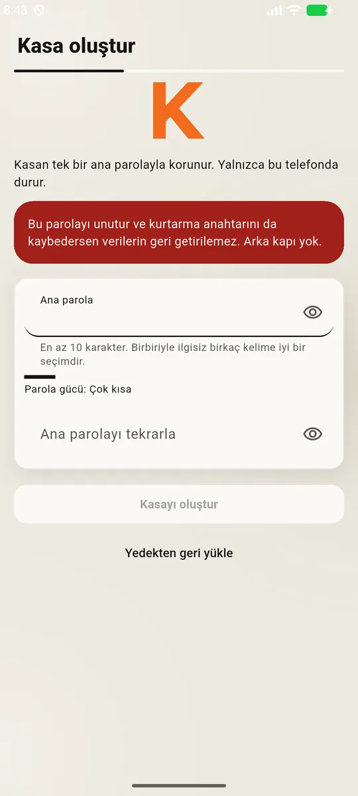
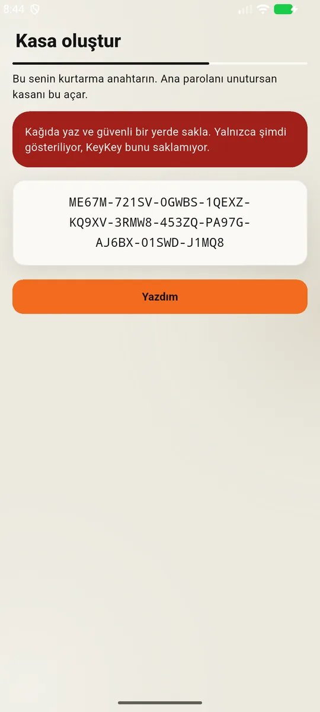
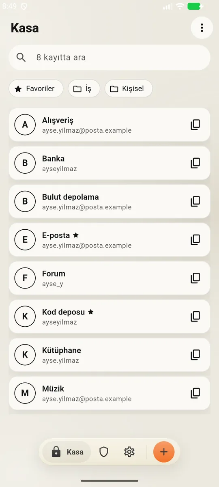
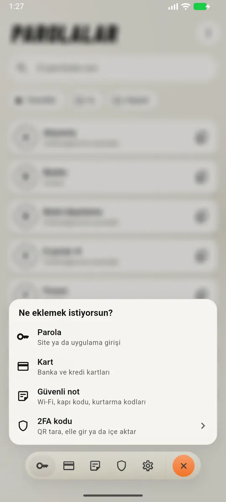
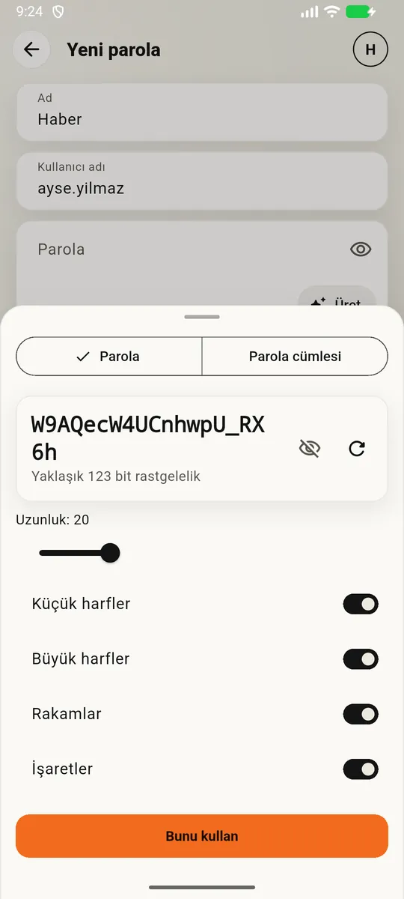
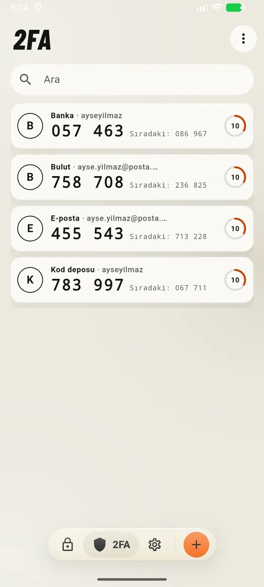
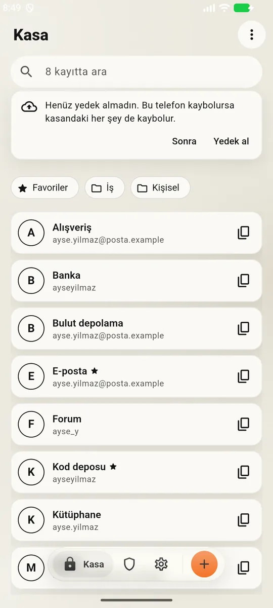
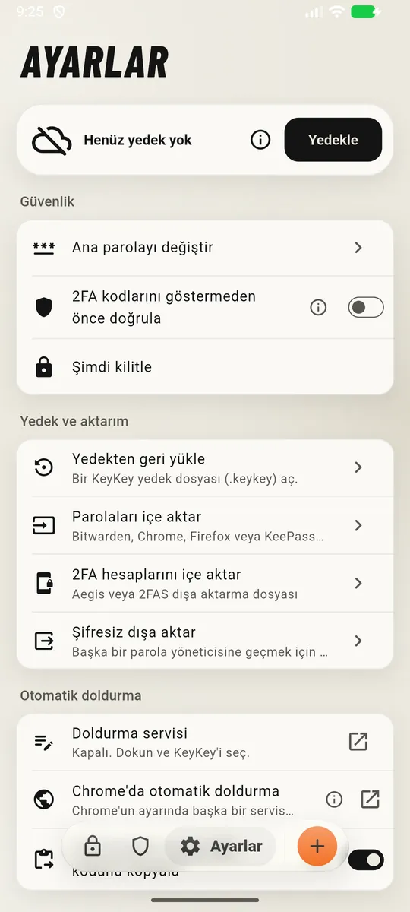
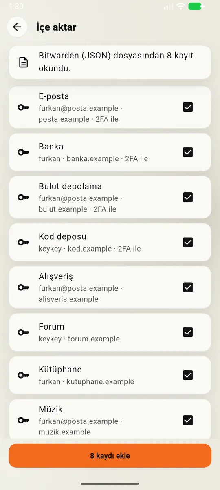

# KeyKey kullanım kılavuzu

KeyKey, parolalarını ve 2FA kodlarını yalnızca telefonunda, şifreli olarak saklayan bir uygulama. Hesap açman gerekmez, internete bağlanmaz. Bu kılavuz kurulumdan yedeklemeye kadar her şeyi adım adım anlatıyor.

Görüntülerdeki kayıtlar örnektir.

## İçindekiler

- [Kurulum](#kurulum)
- [İlk kasa](#ilk-kasa)
- [Kilit ve parmak izi](#kilit-ve-parmak-izi)
- [Parolalar](#parolalar)
- [2FA kodları](#2fa-kodları)
- [Otomatik doldurma](#otomatik-doldurma)
- [Yedekleme ve yeni telefona geçiş](#yedekleme-ve-yeni-telefona-geçiş)
- [Başka uygulamalardan geçiş](#başka-uygulamalardan-geçiş)
- [Görünüm](#görünüm)
- [Bilinen sınırlar](#bilinen-sınırlar)

## Kurulum

KeyKey Android 11 ve üstünde çalışır. Şimdilik yalnızca GitHub'dan dağıtılıyor.

1. [Sürümler sayfasından](https://github.com/aaudraa/KeyKey/releases) son sürümün `keykey-<sürüm>.apk` dosyasını indir.
2. Dosyayı aç. Telefon, tarayıcının ya da dosya uygulamasının uygulama yüklemesine izin vermeni isteyebilir; izin verip kur.
3. Google Play Protect, KeyKey'i daha önce görmediği için uygulama taraması önerebilir. Taramayı seçersen APK Google'a gönderilir. Göndermek istemezsen "Diğer ayrıntılar"ı açıp "Taramadan yükle"ye dokun (İngilizce arayüzde "More details" → "Install without scanning").

**Güncellemeler için:** [Obtainium](https://github.com/ImranR98/Obtainium) uygulamasına bu deponun adresini (`https://github.com/aaudraa/KeyKey`) eklersen yeni sürüm çıktığında haber verir ve kurar. Telefonda Obtainium kuruluysa [bu bağlantıyla](https://apps.obtainium.imranr.dev/redirect?r=obtainium://app/%7B%22id%22%3A%22io.github.aaudraa.keykey%22%2C%22url%22%3A%22https%3A%2F%2Fgithub.com%2Faaudraa%2FKeyKey%22%2C%22author%22%3A%22aaudraa%22%2C%22name%22%3A%22KeyKey%22%7D) KeyKey'i tek dokunuşla ekleyebilirsin. Bağlantı önce tarayıcıda Obtainium'un yönlendirme sayfasını açar. Chrome'da Obtainium kendiliğinden açılır; açılmazsa (Firefox'ta böyle) sayfadaki "Click here if you are not redirected" düğmesine dokun. Obtainium kurulu değilse aynı sayfada indirme bağlantısı var. Obtainium içe aktarmayı onaylamanı ister; eklendikten sonra en son sürüm "Bilinmeyen" görünürse listeyi aşağı çekip yenile. KeyKey telefonda henüz yoksa listede "Kurulu değil" görünür: üstüne dokunup kur düğmesine bas. Android ilk seferde Obtainium'a uygulama yükleme izni vermeni ister (Samsung'da "Bilinmeyen uygulamaları yükle" listesinde Obtainium'un düğmesini aç, sonra geri dön); Play Protect de yukarıdaki uyarıyı gösterebilir.

**İndirdiğin uygulamanın gerçekten KeyKey olduğunu denetlemek için:** [AppVerifier](https://github.com/soupslurpr/AppVerifier) gibi bir uygulamayla KeyKey'in imza özetine bak. Şu değer olmalı:

```
66ff7b5c0c009a8530d0a55dd1d80a3af35de48bd0667c456a0cf86a6d1129a0
```

Bilgisayarda denetlemek istersen [yayın belgesindeki](yayin.md) "İndirilen APK'yı doğrulamak" adımlarını izle.

## İlk kasa

Uygulamayı ilk açtığında kısa, hareketli bir tanıtım gelir: KeyKey'in ne olduğu, menüde nerede ne bulunduğu, otomatik doldurma, başka uygulamalardan geçiş ve yedek. Kaydırarak ya da **İleri** ile geçebilir, sağ üstteki **Atla** ile hemen kasa oluşturmaya geçebilirsin. Sonra yeniden izlemek istersen: Ayarlar → Hakkında → **Tanıtımı yeniden göster**.

Kasa oluşturmadan önce [kullanım koşulları](kosullar.md) gelir: verilerinin nerede durduğu, kasanın nasıl korunduğu, nelerin senin elinde olduğu ve garanti olmadığı. "Okudum, anladım ve kabul ediyorum" kutusunu işaretleyip **Kabul et ve devam et**'e dokunursun. Koşullar bir kez sorulur; Ayarlar → Hakkında → **Kullanım koşulları**'ndan yeniden okuyabilirsin. KeyKey'i daha önce kullanıyorsan güncellemeden sonra kilit ekranından önce bir kez gösterilir.

 

1. **Ana parolanı seç.** Kasanı bu parola korur. En az 10 karakter olmalı; birbiriyle ilgisiz birkaç kelimeden oluşan bir cümle hem güçlü hem akılda kalıcıdır. Güç göstergesi parolanın ne kadar tahmin edilebilir olduğunu söyler.
2. **Kurtarma anahtarını kaydet.** Kasa oluşunca uzun bir kurtarma anahtarı gösterilir. Ana parolanı unutursan kasanı yalnızca bu açar. Yalnızca bu bir kez gösterilir, KeyKey onu saklamaz. Ekran görüntüsü alınamaz; kağıda yazabilir, **Kopyala** ile başka bir parola yöneticisine yapıştırabilir ya da **Dosyaya kaydet** ile metin dosyası olarak kaydedebilirsin. Dosyayı telefonda bırakma: anahtarı bulan kasanı açabilir. Sonraki adımda anahtarı yazar, yapıştırır ya da **Dosyadan oku** ile kaydettiğin dosyadan alırsın.
3. **Anahtarı doğrula.** Yazdığını göstermek için anahtarı bir kez yazarsın, kasa açılır.

> [!IMPORTANT]
> Ana parolanı da kurtarma anahtarını da kaybedersen verilerin geri getirilemez. Bunu yapabilecek bir sunucu ya da arka kapı yok.

Eski telefonundan bir KeyKey yedeğin varsa kasa oluşturmak yerine **Yedekten geri yükle**'ye dokun ([ayrıntılar](#yedekleme-ve-yeni-telefona-geçiş)).

## Kilit ve parmak izi


- KeyKey arka plana geçtiği anda ve 5 dakika dokunulmazsa kilitlenir. Ayarlar'daki **Şimdi kilitle** ile hemen kilitleyebilirsin. Kilidi açınca kaldığın yere dönersin: 2FA sekmesindeysen 2FA'ya, bir kaydın ayrıntısındaysan o kayda.
- **Parmak izi:** Ayarlar → Güvenlik → **Parmak iziyle aç**. Telefonunda parmak izi kayıtlı olmalı. Ana parola her zaman geçerlidir. Telefona yeni bir parmak izi eklersen ya da ekran kilidini kaldırırsan güvenlik gereği parmak iziyle açma kapanır; ana parolayla açıp yeniden açabilirsin.
- **Yanlış parola:** Birkaç hatalı denemeden sonra yeni deneme için kısa bir süre beklemen gerekir; süre denemeler arttıkça uzar.
- **Parolamı unuttum:** Kilit ekranındaki bu bağlantıyla kurtarma anahtarını girip kasayı açarsın, ardından yeni bir ana parola belirlersin.
- **Ana parolayı değiştirmek için:** Ayarlar → Güvenlik → **Ana parolayı değiştir**. Daha önce aldığın yedekler eski parolayla açılmaya devam eder; değişiklikten sonra çıkan nottan yeni bir yedek alıp eskilerini silebilirsin.

## Parolalar

 

**Kasa** sekmesi bütün kayıtlarını gösterir. Üstteki kutuyla arayabilir, **Favoriler** ve klasör düğmeleriyle süzebilirsin. Sağ üstteki **⋮** menüsünden ada ya da son değişene göre sıralarsın; seçimin kilitten sonra da kalır. Kartın sağındaki simge parolayı doğrudan kopyalar. Kasa boşken başka bir uygulamadan **Parolaları içe aktar** ya da **Yedekten geri yükle** kısayollarını da görürsün.

Bir kayda dokununca ayrıntıları açılır: kullanıcı adı, parola, bağlı 2FA kodu, web adresi ve klasör. Her satırın yanında kopyalama düğmesi var. Parola **Göster**'e dokunana kadar gizli kalır. Web adresinin yanındaki **Siteyi aç** sayfayı tarayıcında açar. Düzenlemek için üstteki kalem simgesine dokun. Kaydı favorilere eklemek ya da çöpe taşımak için ayrıntı ekranının sağ üstündeki **⋮** menüsünü kullan.

**Kopyalanan parola 30 saniye sonra panodan kendiliğinden silinir.** Android 13 ve üstünde pano önizlemesinde de görünmez.

### Yeni parola

  

1. Alttaki turuncu **+** düğmesine dokun ve **Parola**'yı seç.
2. Ad, kullanıcı adı, parola ve web adresini yaz. Not, klasör, özel alan ve başka site **Daha fazla seçenek**'in altında. Klasör kutusu var olan klasörlerini önerir.
3. Yeni bir parola istiyorsan **Üret**'e dokun. Rastgele karakterlerden ya da kelimelerden (**Parola cümlesi**) parola üretebilir, uzunluğunu ve içereceği karakterleri seçebilirsin. **Bunu kullan** parolayı forma koyar; seçtiğin uzunluk ve türler bir dahaki sefere hatırlanır.
4. **Kaydet**.

Bir parolayı değiştirdiğinde eskisi kaydın geçmişinde kalır.

### Çöp kutusu ve parola raporu

Kasa ekranının sağ üstündeki **⋮** menüsünde:

- **Çöp kutusu:** Sildiğin kayıtlar burada 30 gün durur, sonra kalıcı olarak silinir. Yanlışlıkla sildiğini buradan geri yüklersin. Çöp kutusunun **⋮** menüsünde **Tümünü geri yükle** ve onay isteyen **Çöpü boşalt** var.
- **Parola raporu:** Zayıf ve birden çok kayıtta kullandığın parolaları gösterir. Hesaplama telefonda yapılır, hiçbir yere gönderilmez.

## 2FA kodları



KeyKey, Google Authenticator gibi bir doğrulama uygulamasının yerini tutar: giriş yaparken istenen 6 haneli kodları üretir.

**Hesap eklemek için** **+** → **2FA kodu**, sonra:

- **QR kodu tara:** Sitenin iki adımlı doğrulama ayarında gösterdiği QR kodunu kamerayla okut.
- **Görseldeki QR kodunu oku:** QR kodun ekran görüntüsü ya da fotoğrafı varsa onu seç.
- **Anahtarı elle gir:** Site QR yerine bir metin anahtarı veriyorsa onu yaz.
- **Başka uygulamadan aktar:** Google Authenticator'ın dışa aktarma QR'ları, Aegis ve 2FAS dosyaları.

Henüz hesabın yoksa listedeki **Başka uygulamadan aktar** kısayolu da aynı yere götürür. Aynı gizli anahtarla bir hesap zaten varsa (çöp kutusundakiler de) KeyKey uyarır; istersen yine de eklersin.

**Kullanırken:** Koda dokununca kopyalanır. Sağdaki halka kodun kaç saniye daha geçerli olduğunu gösterir; son saniyelerde atmaya başlar. Karta uzun basınca düzenleme, favori ve silme seçenekleri açılır.

Bir parola kaydıyla aynı siteye ait 2FA hesabı o kayda bağlanabilir. Kodu o zaman kaydın ayrıntısında da görürsün.

**Ek onay (isteğe bağlı):** Ayarlar → Güvenlik → **2FA kodlarını göstermeden önce doğrula** açıksa, kodlar gösterilmeden önce parmak izi ya da ana parola istenir. Kilidi açık telefonun başkasının eline geçmesine karşı ek bir katmandır.

## Otomatik doldurma


KeyKey, uygulamalardaki ve Chrome'daki giriş formlarını doldurabilir, yeni girdiğin parolaları kaydetmeyi önerebilir.

**Açmak için:**

1. Ayarlar → Otomatik doldurma → **Doldurma servisi**'ne dokun ve açılan listeden **KeyKey**'i seç.
2. Chrome kullanıyorsan **Chrome'da otomatik doldurma**'ya dokun. Chrome'un ayarında "başka bir servisle otomatik doldurma" seçeneğini seç, ardından Chrome'un gösterdiği **Chrome'u yeniden başlat** düğmesine dokun. Dokunmazsan seçim kaybolur.

**Kullanırken:**

- Bir giriş kutusuna dokununca klavyenin üstünde ya da kutunun altında **KeyKey ile doldur** önerisi çıkar. Dokunursun, KeyKey'i parmak izi ya da ana parolayla açarsın.
- O uygulamaya ya da siteye ait tek bir kayıt varsa hemen doldurulur ve "… dolduruldu" bildirimi çıkar. Birden fazla varsa listeden seçersin.
- **Uyarılar:** KeyKey bir şeyden emin olmadığında doldurmadan önce sorar. Örneğin kayıt bu uygulamaya bağlı değilse, sayfa şifresiz (`http`) bağlantıyla açılmışsa ya da uygulamanın imzası kayıttakinden farklıysa (sahte uygulama olabilir). Uyarıyı okumadan geçme.
- İlk kez bir uygulamada doldururken kaydı o uygulamaya bağlayabilirsin; sonraki seferler kendiliğinden eşleşir. Bağlama, uygulamanın imza sertifikasıyla yapılır, yani aynı adı taşıyan sahte bir uygulama eşleşmez.
- **Kaydetme:** Yeni bir hesap açtığında ya da parolanı değiştirdiğinde Android kaydetmeyi önerir. KeyKey'in ekranında kaydı görür, istersen düzenleyip kaydedersin.
- **2FA kodu:** Doldurduğun kayda bağlı bir 2FA hesabı varsa güncel kod panoya kopyalanır; kod kutusuna yapıştırman yeter. Ayarlar'daki **Doldurduktan sonra 2FA kodunu kopyala** ile kapatılabilir.

## Yedekleme ve yeni telefona geçiş

 

KeyKey verilerini hiçbir yere göndermediği için **telefon kaybolursa ya da bozulursa yedeğin yoksa kasan da gider.** Yedek almayı alışkanlık edin.

**Yedek almak için:** Ayarlar'ın en üstündeki **Yedekle**'ye dokun ve dosyanın kaydedileceği yeri seç. Drive gibi bir bulut klasörü seçebilirsin; KeyKey yalnızca dosyayı oraya bırakır, internete kendisi çıkmaz.

- Yedek dosyası (`.keykey`) şifrelidir. Yedeği aldığın andaki ana parolanla ya da kurtarma anahtarınla açılır.
- Son yedekten sonra bir şey değiştiyse ve yedek 14 günden eskiyse kasa ekranında hatırlatma çıkar. **Sonra** dersen 7 gün susar.

**Yeni telefonda:** KeyKey'i kur, ilk ekranda **Yedekten geri yükle**'ye dokun, yedek dosyasını seç ve yedeği aldığın andaki ana parolayı ya da kurtarma anahtarını gir. Kasan olduğu gibi gelir. Parmak izini yeni telefonda yeniden açman gerekir.

**Açık bir kasaya geri yüklemek için:** Ayarlar → Yedek ve aktarım → **Yedekten geri yükle**. İki seçenek çıkar:

- **Birleştir:** Yedekteki kayıtlar kasana eklenir. Aynı kayıt iki yerde de varsa daha yeni olan kalır.
- **Değiştir:** Kasan silinir, yerine yedek gelir. Geri alınamaz, bu yüzden ayrıca onay ister.

## Başka uygulamalardan geçiş



**Parolalar:** Ayarlar → Yedek ve aktarım → **Parolaları içe aktar**. Bitwarden (şifresiz JSON ya da CSV), Chrome, Firefox ve KeePassXC dışa aktarma dosyalarını okur. Kayıtlar eklenmeden önce liste halinde gösterilir; kasanda zaten olanlar işaretlenir ve seçilmez. Bitwarden ve KeePassXC'deki 2FA anahtarları da 2FA hesabı olarak eklenir.

> [!WARNING]
> Dışa aktarma dosyası şifresizdir; içinde bütün parolaların düz metin olarak durur. İçe aktardıktan sonra dosyayı Dosyalar uygulamasından ya da Drive'dan kendin sil. KeyKey bu dosyayı silemez.

**2FA hesapları:** Ayarlar → Yedek ve aktarım → **2FA hesaplarını içe aktar** (Aegis, 2FAS), ya da **+** → **2FA kodu** → **Başka uygulamadan aktar** (Google Authenticator'ın dışa aktarma QR'ları da). Şifreli dosyalar için o uygulamada belirlediğin parola istenir.

**KeyKey'den ayrılmak istersen:** Ayarlar → Yedek ve aktarım → **Şifresiz dışa aktar**, çoğu parola yöneticisinin okuyabildiği bir CSV dosyası verir. Dosya şifresiz olduğu için önce uyarı çıkar ve kimliğini doğrulaman istenir.

## Görünüm

 

Ayarlar → Görünüm → **Tema**: **Sistem** (telefonunun ayarını izler), **Açık** ya da **Koyu**. Seçim kilit ekranında ve otomatik doldurma penceresinde de geçerlidir.

Telefonunda "Animasyonları kaldır" erişilebilirlik ayarı açıksa KeyKey'in hareketleri de kapanır.

Ayarlar → Hakkında → **Lisanslar**: önce KeyKey'in kendi lisansı (GPL-3.0), sonra KeyKey'in kullandığı parçalar ne işe yaradıklarıyla (şifreleme, veritabanı, QR kod okuma, sözcük listeleri…), en sonda bütün paketlerin lisans metinleri.

## Bilinen sınırlar

- **Bazı uygulamalar otomatik doldurmayı desteklemiyor.** Bazı uygulamalar giriş kutularını Android'in doldurma sistemine bildirmiyor; bu ekranlarda öneri hiç çıkmaz. Aynı ekranda Google'ın ve Samsung'un parola yöneticileri de çalışmaz. Kullanıcı adını ve parolayı KeyKey'den kopyalayıp yapıştır; pano 30 saniye sonra temizlenir.
- **Samsung Internet desteklenmiyor.** Bu tarayıcı başka bir doldurma servisine istek göndermiyor, yalnızca kendi kayıtlı parolalarını ve Samsung Pass'i öneriyor. Parolayı KeyKey'den kopyalayarak girebilir ya da Chrome gibi bir tarayıcı kullanabilirsin. Samsung klavyesiyle uygulamalarda doldurma çalışıyor.
- **Chrome'da ayrı bir ayar gerekiyor.** [Otomatik doldurma](#otomatik-doldurma) bölümündeki ikinci adımı atlarsan Chrome kendi parola yöneticisini kullanmaya devam eder.
- **Eşitleme yok.** KeyKey internete çıkmadığı için iki telefon arasında kendiliğinden eşitlenmez. Kayıtları başka bir telefona yedekle taşırsın.
- **Ekran görüntüsü alınamaz.** KeyKey ekrandayken ekran görüntüsü ve ekran kaydı engellenir, son uygulamalar listesinde de içeriği görünmez. Bu bilerek yapılır.
- **Kilidi açık telefon.** KeyKey açıkken telefonu eline alan biri ekrandaki kayıtları görebilir. Arka plana geçince hemen kilitlenmesi ve 2FA için ek onay bu riski azaltır.

Güvenlik tarafındaki sınırlar ve neyin korunduğu [güvenlik tasarımı belgesinde](guvenlik-tasarimi.md#bilinen-sınırlar), verilerinle ne yapıldığı [gizlilik bildiriminde](gizlilik.md) anlatılıyor.
